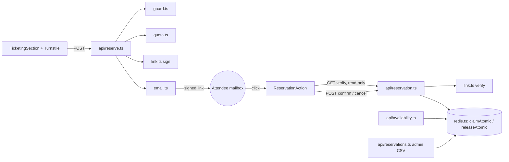

# ADR-002: Claim seats on email confirmation instead of holding them on submit

## Overview

Today `POST /api/reserve` holds seats as `pending` for 48h before the person proves they own the email address.
The audit (`analysis-billetterie.md`) found this lets anyone fill a show with made-up addresses, forces an expiry
sweep on every request, and burns the free email quota. This ADR changes the model: submitting the form only
validates and emails a **signed link**; no seat is held and nothing is written to Redis. The seat is claimed
atomically when the person clicks the confirm button. The same change settles five related launch blockers
(abuse limits, email failure handling, preview/production separation, retention, runtime open/closed gate).

Chosen over A (edge guard, keep hold model) and C (in-app limits, no new vendor); see Trade-offs.

## Architecture

### Component Diagram

### Data Flow

1. Form posts `{showId, name, email, quantity, turnstileToken}` to `/api/reserve`.
2. `guard.ts` rejects without touching Redis: method, Content-Type, Origin, body size, field validation, runtime
   `RESERVATIONS_OPEN` gate. Turnstile is verified next.
3. `quota.ts`: per-address send cooldown (`SET NX EX 600`) and the daily send budget; both fail closed with a
   clear French message.
4. One read-only precheck (show booked counter, canonical-email count) refuses obviously impossible requests early.
5. `link.ts` signs `{v, purpose:'confirm', showId, name, email, quantity, exp, nonce, kid}`; the reservation id is
   derived from the signature (8 hex, same shape as today).
6. `email.ts` sends the confirm link with a timeout. Provider failure and bad-address failure return different errors.
7. Click opens `/billetterie?confirmer=<id>&token=<signed>`; `GET /api/reservation` verifies the signature and returns
   a read-only preview with current availability (link scanners are safe).
8. Button `POST confirm` runs `claimAtomic` (Lua): refuses a tombstoned id, treats an existing record as already
   confirmed (idempotent), enforces capacity, the per-address cap on the canonical key and the per-domain cap,
   writes the record as `confirmed` with a random cancel token, and sets `EXPIREAT` to show start + 30 days.
9. Recap email carries the cancel link; `emailSent` is returned honestly. `POST cancel` runs `releaseAtomic`:
   status becomes `cancelled`, counters decrement, a tombstone key blocks replay of the original confirm link.

## Components

| Component | Responsibility | Interface | Depends on |
|-----------|----------------|-----------|------------|
| `api/_lib/guard.ts` (new) | All rejections that need no Redis; canonical email key; open gate | pure functions | `shows.ts` |
| `api/_lib/link.ts` (new) | Sign and verify confirm links; derive id; two-secret rotation | `signLink`, `verifyLink` | env secrets |
| `api/_lib/quota.ts` (new) | Send cooldown and daily send budget | `checkSendQuota` | `redis.ts` transport |
| `api/_lib/http.ts` (new) | Shared `error()` / JSON helpers and error strings | small helpers | none |
| `api/_lib/redis.ts` (reduced) | Transport, key schema, `claimAtomic`, `releaseAtomic`; no sweep, no pending list | as today minus confirm/sweep | env |
| `api/_lib/email.ts` | Templates, timeouts, error classes, no recipient in logs | `sendConfirmRequest`, `sendRecap`, `sendCancellation` | `link.ts` |
| `api/reserve.ts`, `reservation.ts`, `availability.ts`, `reservations.ts` | Orchestration only | HTTP | the above |
| `TicketingSection.tsx`, `ReservationAction.tsx` | Turnstile widget, privacy notice, honest states (full, already confirmed, email not sent), refetch availability on every error | UI | API |
| Config | `PUBLIC_SITE_URL` derived from `VERCEL_ENV`/`VERCEL_URL`; one Upstash database per environment; env matrix in docs | env | Vercel |

Out of scope (follow-up): attendee broadcast, door check-in, waitlist, admin bulk cancel by domain.

## Design Principles Validation

### SOLID
- [x] **Single Responsibility**: `redis.ts` loses the sweep and pending list; validation, signing, quota and HTTP helpers each get one module.
- [x] **Open/Closed**: show data stays in `shows.ts`; new shows need no code change.
- [x] **Liskov Substitution**: no inheritance introduced.
- [x] **Interface Segregation**: endpoints depend only on the helpers they call.
- [x] **Dependency Inversion**: the Turnstile verifier and clock are injected so tests swap them (no network in tests).

### DRY
- [x] Duplicate `error()` helper and the "Service indisponible" literals move into `http.ts`.
- [x] `formatDateTime` duplicated in email.ts and TicketingSection.tsx moves to a shared module in `src/lib` (shows.ts is already shared).
- [x] Limits (`MAX_TICKETS_PER_EMAIL`, domain cap, budget, cooldown) live in one config block.

### KISS
- [~] Four small new modules for a small project. Justified: each is pure and unit-testable, which the current code lacks. Warning, not blocking.
- [x] Removing the pending list, the confirm script and the sweep deletes more code than is added to `redis.ts`.

### YAGNI
- [~] Per-domain cap is the only defence against a catch-all-domain attacker; marked contestable (◐) and tunable. All other pieces answer a finding from the audit.

### Design Patterns
- [x] **Structural**: Facade (`redis.ts` hides Lua and keys).
- [x] **Behavioral**: Strategy by injection (Turnstile verifier, clock).
- [x] **No forced patterns**.

### Other Principles
- [x] **Separation of Concerns**: validation, signing, quota, persistence, delivery are separate.
- [x] **Composition over Inheritance**.
- [x] **Law of Demeter**: handlers call helpers, not through them.
- [x] **Fail Fast**: guard rejects before any network or Redis call; missing secrets fail closed in production.

## Trade-offs

| Decision | Option A (edge guard, keep holds) | Option B (claim on confirm) | Option C (in-app limits) | Choice |
|----------|-----------------------------------|-----------------------------|--------------------------|--------|
| Hoarding by unverified addresses | Throttled by cap, still possible | Impossible by design | Throttled by cap | B |
| Expiry sweep | Stays (serial, per request) | Removed | Stays | B |
| UX | Seats feel secured | "Complet" possible after click | Seats feel secured | A/C better; mitigated by wording and a read-only preview |
| Redis quota | Limiter at the edge | Fewer commands (no sweep, no pending) | Rejected requests cost commands | B |
| Effort | ~6h | ~12-16h | ~5h | B costs more, removes more |
| Weighted score | ~7.0 | ~7.3 | ~5.8 | B |

## Refactoring Impact

### Changed Interfaces

| Component | Change | Consumers | Impact |
|-----------|--------|-----------|--------|
| `POST /api/reserve` response | `{ok, linkExpiresAt}`; no `reservationId` | `TicketingSection.tsx` | BREAKING (ships together) |
| `GET/POST /api/reservation` | Signed token instead of stored token for confirm; cancel unchanged | `ReservationAction.tsx`, `BilletteriePage.tsx` | BREAKING (ships together) |
| `redis.ts` exports | Remove `confirmAtomic`, `releaseExpired`, pending key; add `claimAtomic` | all four `api/*.ts`, `email.ts` (type import) | BREAKING (same PR) |
| `email.ts` | Templates take a signed link; honest result | `reserve.ts`, `reservation.ts` | BREAKING (same PR) |
| `GET /api/availability` | No sweep; adds `open`; `s-maxage=10` | `TicketingSection.tsx` | DEPRECATION-free, additive |
| Existing `?confirmer=` links | none in the wild (production has no `/api` yet) | none | TRANSPARENT |

### Migration Plan

1. Before launch, flush or recreate the Redis database used by Preview/Production (it holds test reservations;
   whether Preview and Production share it is unverified).
2. Ship API and frontend in one deploy; no compatibility period is needed.
3. Rollback: revert the deploy; the reserve script and record shape stay compatible with the old `redis.ts`
   except the new `status` values.

### Migration Strategy
- [ ] Phased migration: no (few consumers, same repo, one deploy).
- [ ] Backward compatibility period: no.
- [x] Feature flag: `RESERVATIONS_OPEN` runtime gate covers gradual opening.

## Key Assumptions

| Assumption | Marker | Evidence |
|------------|--------|----------|
| Vercel Hobby allows one rate-limit rule per project (3 custom rules) | ✓ Validated | Vercel WAF rate-limiting docs, checked 2026-10-27 |
| Default 429 action works on Hobby | ~ Contestable | One unconfirmed community report of an upgrade prompt |
| Resend free tier is 100 emails/day and 3,000/month; a booking sends up to 3 emails | ✓ Validated | Resend quota docs; email.ts |
| Upstash free tier is 500K commands/month (not 10K/day) | ✓ Validated | Upstash billing docs; corrects the audit's performance report |
| Preview and Production share one Redis | ◐ Blind spot | Not checked; verify in the Vercel dashboard |
| Turnstile is free and usable from Hobby | ◐ Blind spot | Not verified in this session |
| No live pending reservations exist at launch | ✓ Validated | Production returns the SPA shell for `/api/availability`; test data in Preview Redis must be cleared |
| "Complet after click" is acceptable to attendees | ~ Contestable | Mitigated by wording and a pre-click availability preview |
| Name and email in the signed URL is acceptable | ~ Contestable | Needs `Referrer-Policy: no-referrer`; link expires |
| A determined attacker with real addresses can still fill a show | ⚡ Oversimplified | Residual; per-domain cap and a follow-up admin bulk cancel limit the damage |
| Per-domain cap of 12 for non-major providers | ◐ Blind spot | A guess; tune before launch |
| Free Resend tier is enough for launch day | ✗ Incorrect | ~33 full bookings/day exhaust 100 emails; plan an upgrade before launch |

## Risk Assessment

| Risk | Impact | Mitigation |
|------|--------|------------|
| Replay of a confirm link after cancel | High | Tombstone key checked by `claimAtomic`; id derived from the signature |
| Double click or two devices books twice | High | Claim keyed by derived id; second call returns "already confirmed" |
| Email bombing a victim address | High | Send cooldown across shows; daily send budget fails closed |
| Resend quota exhausted on launch day | High | Upgrade plan before launch; budget keeps recap and cancel mails flowing |
| Secret rotation kills links in inboxes | Medium | Key id and two accepted secrets during rotation |
| Confirm scanner or auto-click by attacker | Medium | Cannot be prevented; capacity, per-address and per-domain caps bound the damage |
| Signed-link bug (comparison, purpose reuse) | Medium | Constant-time compare, `confirm:v1` prefix, expiry inside the signature, unit tests |
| Lua change without tests | Medium | Redis integration tests (last-seat race, replay, idempotency) written first |

## Implementation Order

1. Test harness for `api/`: local Redis integration tests for the existing scripts (also fixes the Jest resolver).
2. `guard.ts`, `http.ts`, `link.ts` with unit tests.
3. `claimAtomic` / `releaseAtomic` with tombstone, status and `EXPIREAT`; remove the sweep and pending list.
4. `quota.ts`, `reserve.ts` flow, `email.ts` timeouts and error classes.
5. `reservation.ts`, `availability.ts` (cache, `open`), `reservations.ts` hardening.
6. Frontend: Turnstile, privacy notice, honest states, refetch on error, copy gated by the runtime flag.
7. Env matrix and docs; verify Upstash scoping, Turnstile keys and Resend plan; clear test data.
